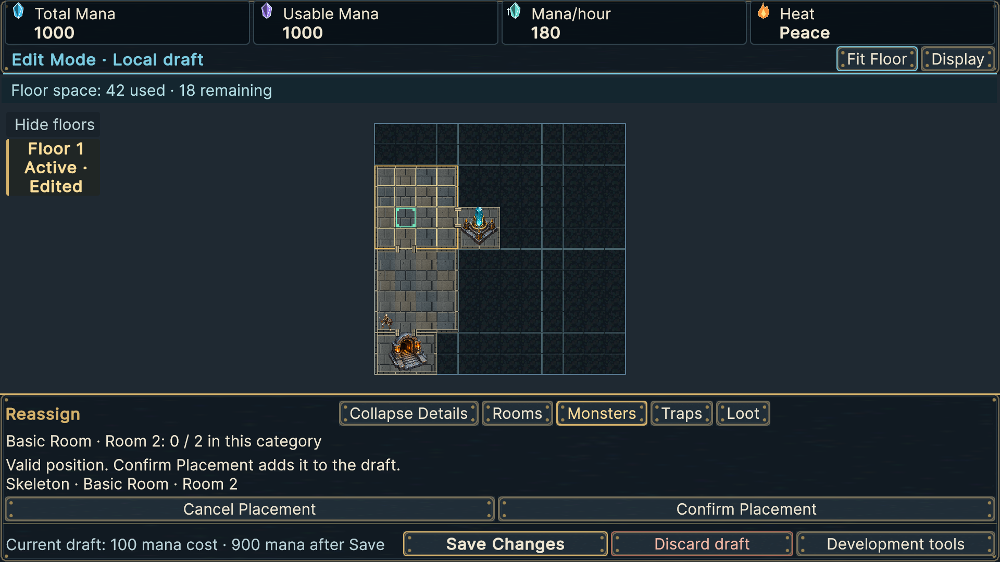

# Production map reassignment capture

The focused capture was reviewed before full qualification; the final freshly generated capture was reviewed again after final PlayMode.

1920 x 1080, Default text. The pending Reassign operation became a valid exact-cell preview in Basic Room 2 after a production mouse tap. The original Skeleton still appears in Room 1 because neither Confirm Placement nor Save Changes has occurred. The destination's warm hollow grid and mint valid cell are visible over masonry; the contextual sheet names Skeleton and Room 2 without coordinates, shows capacity 0/2, and exposes Cancel/Confirm and Save/Discard. The 100-mana quote is the preceding room-construction command; reassignment has zero acquisition cost. This capture is interaction evidence, not proof of the final committed destination, which is covered by Save/reopen assertions.
