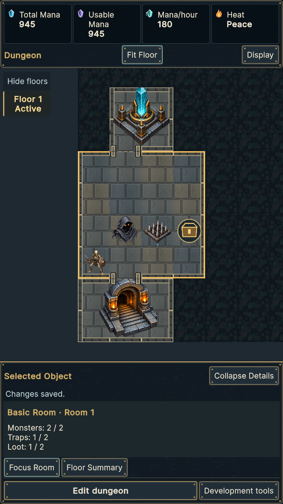
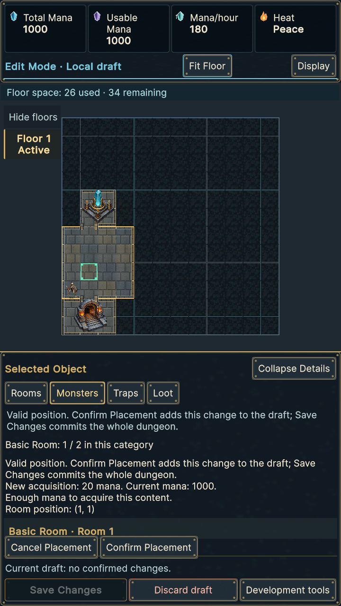
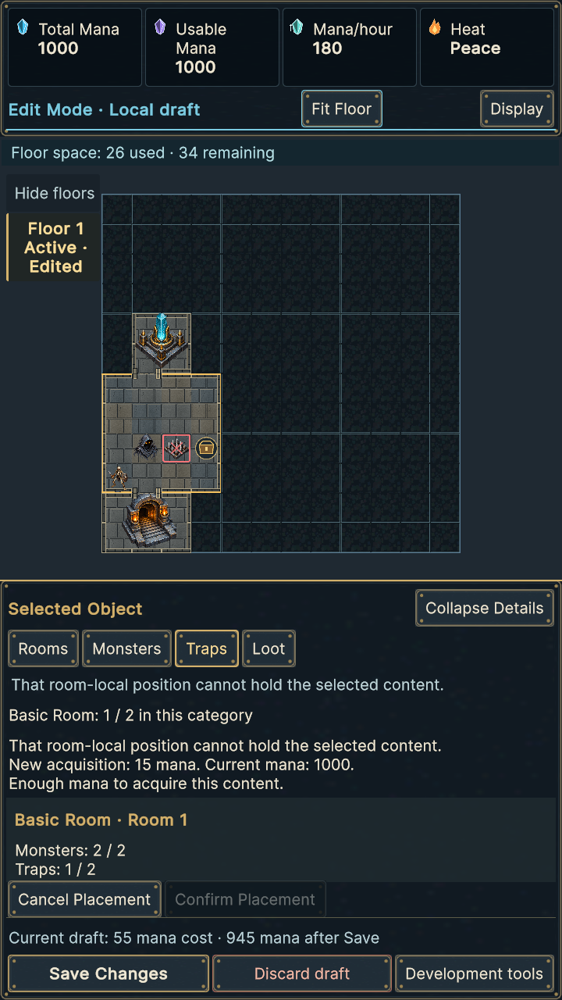
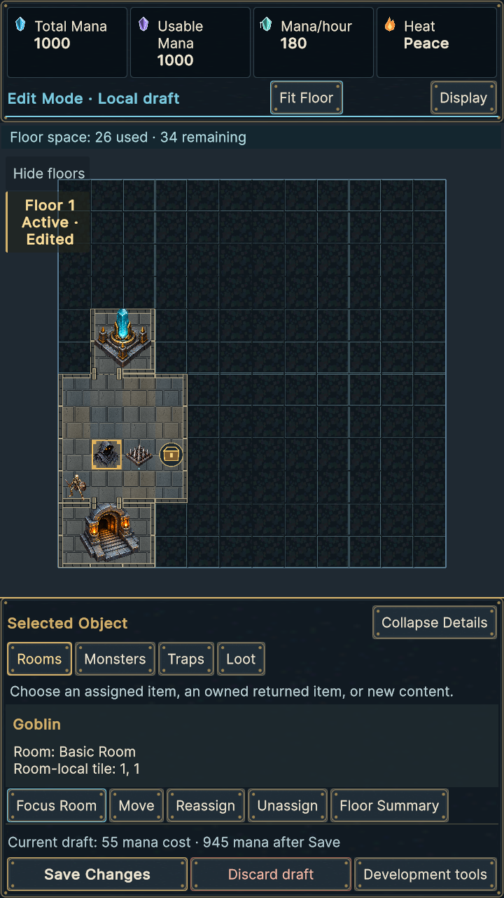
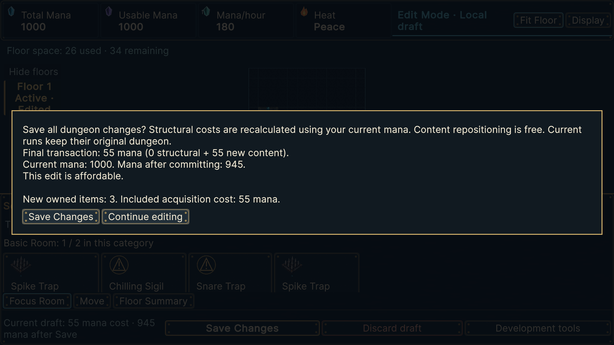

# Actual production Unity captures

Five retained frames from the final production PlayMode journey. Full XML and the screenshot hash index bind these to qualification; these are not mockups. Portrait is 720×1280; transaction review is 1920×1080. Automated assertions additionally cover both orientations at Small, Default and Large text.

## Committed room and capacity

## Valid preview before confirmation

The green occupied cell, local coordinates and configured acquisition quote are visible. Confirm Placement adds one draft command; the wallet and canonical file remain unchanged.

## Invalid overlapping preview

The red occupied cell and localized reason accompany a disabled confirmation button. Cancel returns to choices without adding a command.

## Assigned content selection

Move, Reassign and Unassign operate on the selected stable assignment. Reassignment destinations include the existing localized room ordinal to distinguish equal room definitions.

## Whole-dungeon Save review

The transaction separates structural and new-content charges and shows final wallet/affordability. Continue editing preserves the draft; Save Changes invokes the existing atomic writer. Discard is a separate whole-draft action.

