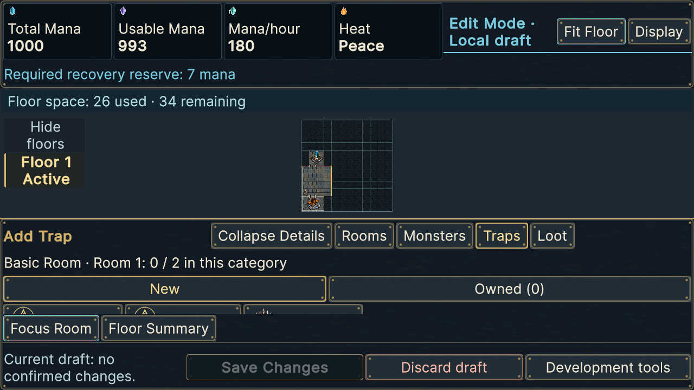
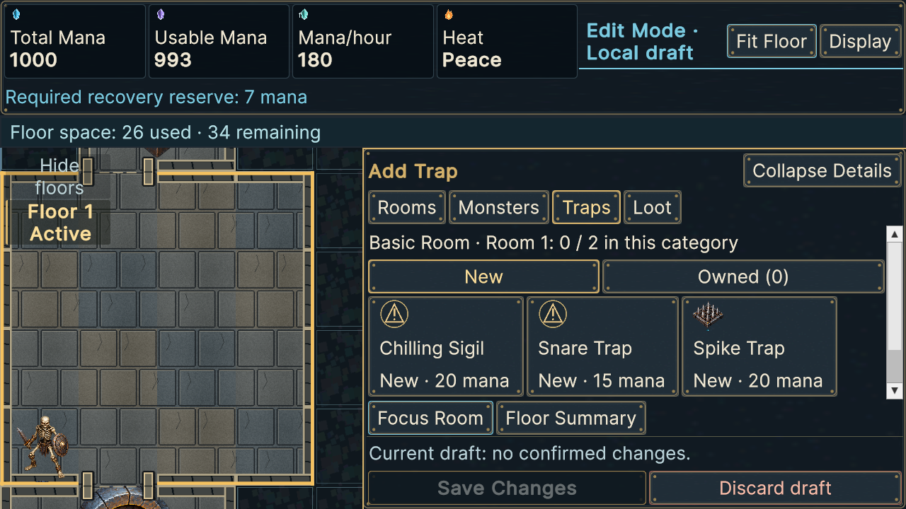
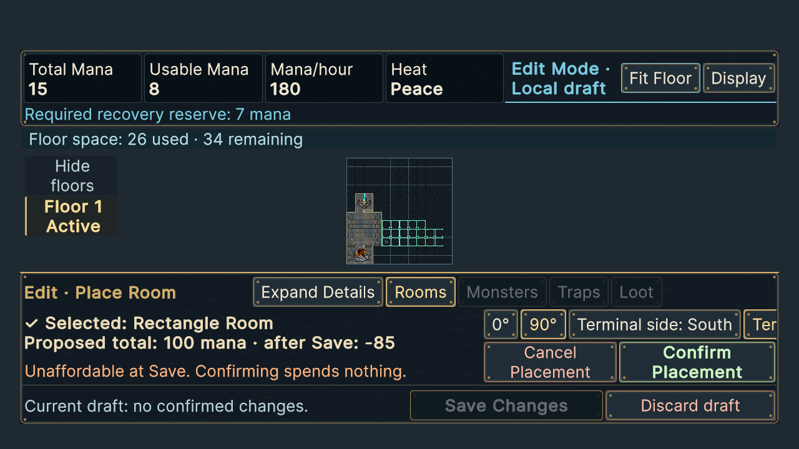
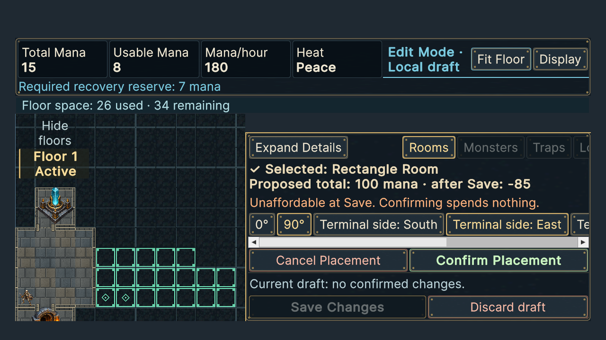
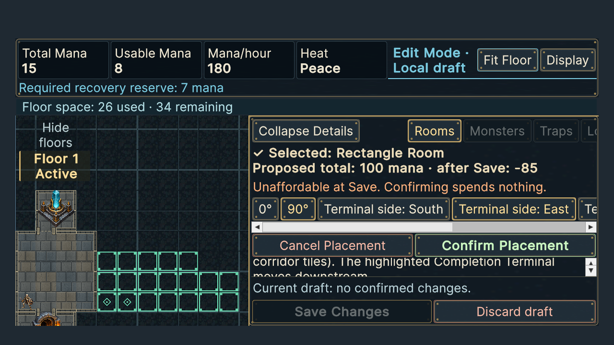
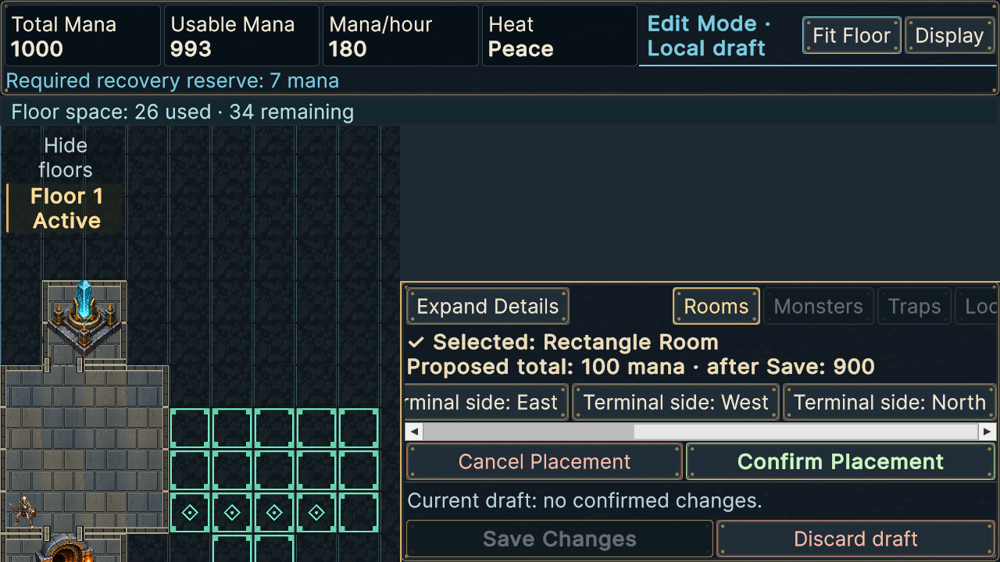

# Actual scene captures — owner usability correction

These are byte-exact copies of actual Unity captures; source paths and SHA-256 values are in [the index](screenshots/index.json). Full resolution/text/details captures remain in [the archive](screenshots.zip). No historical original was regenerated or relabeled.

Trap browsing uses the same funded starter fixture before and after. The original whole-card assertion fails: 142-pixel card versus 119-pixel enclosing viewport. After correction, the viewport is 246 pixels high, all three cards/prices and New/Owned remain visible, and Focus Room no longer covers the choices. Entering placement frames the selected room automatically; actual mouse targets measure about 111 pixels per tile.

Construction comparison below uses the same deliberately **unfunded** fixture and inset safe area; the preserved affordability warning is expected. Map height was 195 collapsed / 156 expanded after the preceding correction. The new map is 486×439 in both states. The funded full-screen representative camera measures about 54 pixels per tile. Confirm remains separate from Save; new confirmation does not fund an unaffordable save.

The native horizontal scrollbar exposes the other terminal options. Tests scroll to every option, verify bounds and panel picking, and dispatch the last terminal button's actual action without confirming a draft mutation.

Inspection assessment: tile targeting and card visibility are substantially improved; labels and distinct actions remain legible at Large. Long, unfunded expanded information can still require vertical scrolling, and the floor overlay can be collapsed to uncover geometry. This is a technical visual assessment, **not owner usability approval**. Physical touch hardware, mobile performance and native-device layouts are not established by these captures.
